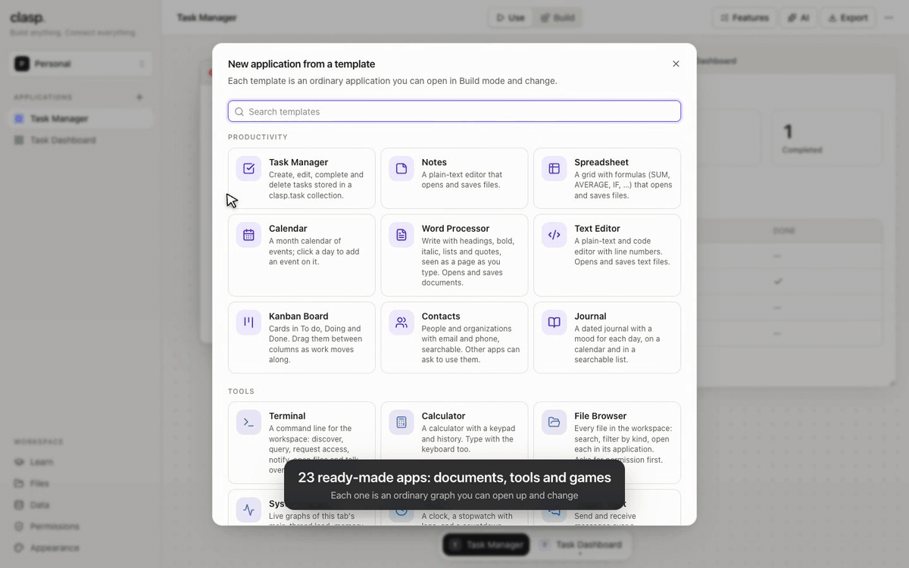

# clasp.

**Build anything. Connect everything.**

<a href="https://github.com/gruberc6006/clasp/raw/main/media/clasp-demo.mp4"></a>

▶ **[Download the full two-minute tour](https://github.com/gruberc6006/clasp/raw/main/media/clasp-demo.mp4)** (MP4, 9 MB). It was
recorded from the real Studio, and the app built in it comes from a real local
model; only the model's wait is sped up. `pnpm demo:video` records it again.

Clasp is a local-first computing platform that feels like a small desktop OS.
Every application is a persistent graph of reusable, deterministic components,
and runs in its own movable windows. Applications share data and capabilities
through one Universal API that checks a permission on every call. You describe
an application by its **features**; Clasp builds the components and wiring. A
local language model can do that describing for you, but nothing at run time
depends on it.

- **A desktop.** Every application runs in windows you can move, resize, minimize, maximize and close. A window bar brings them back.
- **Describe features, not wiring.** "Recipes with servings and a vegetarian flag; add, search, filter, count" becomes a working app.
- **Real documents.** Notes, Word Processor, Text Editor, Spreadsheet (with formulas), Sketchpad and Beat Maker open and save files through Open / Save As dialogs.
- **Everyday tools and games.** Terminal, Calculator, File Browser, System Monitor, Clock, Kanban Board, Contacts and Journal; Tic-tac-toe, Pairs, Word Guess and Glowworm, each with a high-score list.
- **Make it yours.** Light, dark or automatic theme, an accent colour, and a desktop background — a preset or your own picture.
- **Live connections.** Socket Chat talks to WebSocket servers — but only to a server you have allowed that application to use.
- **The graph is the source of truth.** Use mode runs it; Build mode edits that same graph live.
- **Everything connects through one API.** `discover`, `query`, `mutate`, `subscribe`, `invoke`.
- **Nothing is shared by default.** Data access needs a grant from you, scoped to one resource, and revocation is immediate. An application gets only the files you pick for it in a dialog, and reaches only the network hosts you allow it.
- **AI proposes; you approve.** Proposals are validated before you see them and applied as one undoable change. No generated code ever runs.
- **Offline and yours.** IndexedDB storage, portable packages, no accounts or cloud services.

New here? Click **Learn** in the sidebar for two guided tutorials (build an
app with AI, and by hand), or read [docs/tutorial.md](docs/tutorial.md).
[docs/architecture.md](docs/architecture.md) explains how it fits together.

## Quick start

Requires Node 20.17+ and pnpm 10. If `pnpm` is not installed, prefix commands
with `npx -y pnpm@10.34.9` (for example `npx -y pnpm@10.34.9 install`).

```bash
pnpm install
```

```bash
pnpm dev
```

Open http://localhost:5173. The first launch creates a workspace containing
**Task Manager** and **Task Dashboard**, side by side on the desktop. Add more
with **+ → From a template…** in the sidebar: a gallery of 23 applications in
Productivity, Tools, Creative, Games and Examples. Or start a blank application
and build it yourself.

### The desktop

- Drag a window by its title bar; resize it from its right edge, bottom edge or corner.
- The traffic lights close, minimize and maximize it. Double-click the title bar to maximize.
- The window bar at the bottom shows every window, including minimized and closed ones (dimmed); click one to bring it forward, reopen it or minimize it.
- Clicking a window makes its application the selected one, so **Build**, **AI** and **Export** act on it.
- Closing a window keeps the application running; reopen it from the window bar or by selecting the application in the sidebar.
- Rename an application by clicking its name at the top, double-clicking it in the sidebar, or **… → Rename**. An application the AI builds while it is still “Untitled app” is named after what it became (the proposal says so).

### Files

Document applications save **files** in the workspace. **Save** and **Open…**
show dialogs; the file you pick there is the only one that application may
use, and the **Files** section lists which applications can open each file and
lets you take that back. **From this computer…** brings in `.txt`, `.md`,
`.csv` (as a spreadsheet) or Clasp documents, and **Download** saves a copy to
your computer. Document applications reopen the file they last used.

### Tools and games

Every template is an ordinary application: a graph of registered components
that you can open in **Build** mode and change.

- **Word Processor** writes with headings, bold, italic, lists and quotes, and shows the page as you type. It saves Markdown; `.md` files from your computer open in it. Links are only ever `http(s)` or `mailto`, and no HTML is rendered.
- **Text Editor** is a monospaced editor with line numbers and Tab indenting. Its files are text files, so Notes opens them too.
- **Terminal** is a command line *for the workspace*, not for your computer: `discover`, `query`, `request` (access), `notify`, `open` (a file, through the dialog), `connect`/`send` (a socket), `calc`, `history`… Type `help`. It runs no programs and evaluates no code, and it can do only what you allow it, like any application.
- **File Browser** lists every file, with search and kind tabs, and opens each one in its application (creating that application if there is none). It asks first for permission to list your files, and again, once, to open files in other applications.
- **System Monitor** graphs this browser tab's main-thread load, timer lag, frame rate, memory (Chrome only), storage, and the workspace's activity. Browsers do not tell web pages how busy the computer's processor is, so it does not show CPU usage. It needs your permission to read the System service.
- **Clock** (clock, stopwatch with laps, timer), **Calculator** (with history and keyboard input), **Kanban Board** (drag cards between columns), **Contacts** and **Journal** (with a calendar and a mood for each day).
- **Games**: Tic-tac-toe against the computer (easy, normal or perfect), Pairs (a memory game), Word Guess, and Glowworm (an arcade game: arrow keys or WASD). Each keeps a high-score list in its own `clasp.score` collection.

### Editing an application by its features

**Features** in the top bar opens a panel beside the running application. It
shows the records the app keeps and what the app does, in plain words: "A
form to add books (title, author)", "Search books by title", "Sorts books by
title". Each line can be changed (the form starts from how it is now) or
removed, and **Add a feature** offers a new kind of record, forms, lists and
tables, search, filters, sorting, counts, calendars, boards, sharing, the
ready-made tools and games, and document editors. **+ Field** adds a field to
a kind of record and its form.

Before anything changes, the panel shows what will happen, or why it can't
(for example, "Book has no date field"). Every change is one undoable step.
Removing a feature never removes records. Parts built by hand in Build mode
keep working, and the panel says how many there are.

### Appearance

**Appearance** in the sidebar chooses the theme (Automatic follows your
system, or Light, or Dark), an accent colour, and the desktop background:
dots, plain, paper, four gradients, or a picture of your own. Pictures are
scaled down and kept with the workspace on this computer. Each workspace
remembers its own look.

### Network sockets

Applications can hold live connections (WebSockets, `ws://` and `wss://`) to
servers — but never on their own. The first time an application wants a
server, Clasp asks you, naming the host and whether the connection is
encrypted. The permission covers that one application and that one host
(scheme, host and port); another host is another question, and a copy of the
app imported elsewhere starts with no hosts at all. **Permissions** lists each
allowed host with its open connections, and revoking closes them at once.

To try it, start the small chat relay that comes with Clasp (it listens on
this computer only, and passes every message to everyone connected):

```bash
pnpm socket-server
```

Then add **Socket Chat** from **+**, press **Connect** and allow
`localhost:4318`. Add a second Socket Chat and connect it too: the two can now
talk to each other through the relay. Any other WebSocket server works the
same way; type its address into **Server**.

Browsers let web pages open WebSockets but not raw TCP or UDP sockets, so
those are not available. Messages are text (up to 64 KB); binary messages are
dropped.

### Try the two-application demonstration

1. In **Task Manager**, add a task.
2. Open **Task Dashboard**, pick “Tasks · Task Manager”, and click **Request read access**.
3. Click **Allow** in the permission prompt. The task appears in the dashboard.
4. Edit, complete or add tasks in Task Manager. The dashboard updates by itself.
5. Reload the page. Both applications and their data are still there.
6. Open **Permissions** and revoke the dashboard's grant. Its data disappears at once.
7. Click **Export** on the dashboard, create a new workspace from the workspace menu, and import the file with **+ → Import package**. The imported copy has no access to anything.

## Local AI (Ollama)

Clasp talks to any Ollama-compatible server. No API key is needed.

```bash
ollama pull qwen2.5-coder:14b
```

```bash
ollama serve
```

In the Studio, click **AI**. By default it uses `http://localhost:11434` and
picks an installed model, preferring `qwen2.5-coder`. **Settings** in the AI
panel changes the server or model. Describe what the application should do,
not how. For example (on a blank application, **+ → Describe with AI**):

- *A recipe box where I can add recipes with servings and whether they are vegetarian, search them, and filter to vegetarian ones.*
- *Create a simple task manager with a title field, an Add Task button, and a list of tasks.*
- *A spreadsheet that can open and save files.*

On an existing application:

- *Add a filter to show only incomplete tasks.*
- *Let me search tasks by title.*
- *Tasks should also have an estimate in hours.*

Asking for a separate application from inside another one ("make a calendar
app") proposes a **new application**. The proposal card says which application
it will create or change, with one click to switch ("Add to Task Manager
instead" / "Make it a new app instead"). Requests keep running if you switch
applications while the model is thinking, and their answers stay in that
application's conversation.

The model replies in the feature vocabulary
([`packages/features/src/spec.ts`](packages/features/src/spec.ts)); the
feature compiler builds the graph. Each proposal is shown as a list of
features, with the underlying graph changes one click away. Nothing happens
until you click **Apply changes**, and **Undo** reverts it. Changes reuse what
the application has and never delete its data. If no model is reachable, the
panel says so and every application keeps working.

The panel's **Scripted demo provider** setting performs no inference. It
replays predefined feature plans for the task-manager, filter, calendar and
recipe-box requests above (and the tutorial's follow-up), so you can try the
flow without a model. It is labelled "not an AI" wherever it appears.

## Tests

```bash
pnpm typecheck
```

```bash
pnpm test
```

```bash
pnpm test:e2e
```

- `pnpm test` runs 197 unit and integration tests (Vitest). They cover the graph engine, schemas, permissions, IndexedDB storage, the Universal API, the runtime, composition, sharing, extensions, the feature compiler, files and their access rules, network sockets and their per-host permissions (including a real WebSocket server), every template, the tools and games, reading, removing and changing features, the formula engine, the document apps, AI planning and repair, and the two-application scenario without a browser.
- `pnpm test:e2e` runs 25 browser tests (Playwright) against the real Studio. They cover the full two-application demonstration (create, discover, grant, live update, reload, revoke, export, import into another workspace), denial, window management, Build/Use mode editing, forking, the Spreadsheet, Sketchpad and Beat Maker with Save/Open, disk import and download, per-file access, Socket Chat with its permission prompt and revocation, the template gallery (every template opened), the Calculator, Terminal, Word Processor, Kanban Board, File Browser and System Monitor in use, three games played to the end, themes and backgrounds, renaming, building and changing an app in the Features panel, the AI panel (features), behaviour with no model, and both tutorials. Install the browser once with `pnpm exec playwright install chromium`, or use an installed Chrome with `CLASP_E2E_CHANNEL=chrome pnpm test:e2e`.
- `pnpm test:ollama` runs generation against a **real local model**. It builds the task manager, uses it, adds the filter and checks that no records were lost; builds a recipe box with its own kind of record; turns "make a calendar app" into a new application; builds a reading-list kanban board whose cards move between columns; and turns "a calculator" and a request for a memory game into exactly those. It needs Ollama running; Clasp asks it for a 16K-token context so the instructions are never cut off. Pick a model with `CLASP_OLLAMA_MODEL=qwen2.5-coder:14b`. With that model, all five tests passed, in about a minute in total.

## Project layout

```
apps/studio            The Studio (React, Vite, Tailwind, React Flow)
packages/core          Object graph, operations, transactions, undo/redo, validation
packages/schemas       Schema registry (clasp.task, project, note, event, contact, document)
packages/permissions   Capability grants, requests, revocation
packages/persistence   Storage adapters (IndexedDB, memory) and revision history
packages/universal-api The kernel: discover / query / mutate / subscribe / invoke
packages/runtime       Component registry, deterministic runtime, Workspace host
packages/primitives    Interface, data, logic and composition components; editors, tools (calculator, terminal, clock, board, monitor) and games
packages/workflows     Workflow components and the notification service
packages/features      Feature vocabulary and the deterministic feature compiler
packages/files         File service (user-mediated open/save), document component, document feature
packages/network       Network service (sockets to hosts the user allows), socket component
packages/renderer-react Draws running applications, including the editors and their audio
packages/ai            Ollama provider, scripted provider, feature planning, validation and repair
packages/sharing       Package export, import, validation, forking
packages/extensions    Declarative extension packs
examples               The 23 templates: tools, games and the two-application demonstration (many built from features)
scripts                socket-server.mjs: a local chat relay for trying Socket Chat
tests                  Integration tests, e2e/ browser tests
docs                   Architecture and extension notes
```

The workspace packages are consumed as TypeScript source and have no build
step of their own. `pnpm build` produces the Studio in `apps/studio/dist`.

## Creating a new primitive

A component is a machine-readable definition plus a deterministic
implementation. Its definition is the only thing the editor, the runtime and
the AI need.

```ts
import type { ComponentDefinition } from "@clasp/runtime";

export const clamp: ComponentDefinition = {
  type: "math.clamp",
  version: 1,
  category: "logic",
  title: "Clamp",
  description: "Limits a number to the range min..max.",
  properties: [
    { name: "min", type: "number", default: 0, title: "Minimum" },
    { name: "max", type: "number", default: 100, title: "Maximum" },
  ],
  inputs: [{ name: "value", type: "number" }],
  outputs: [{ name: "result", type: "number" }],
  events: [],
  actions: [],
  create: (ctx) => {
    const compute = () => {
      const value = Number(ctx.input("value") ?? 0);
      ctx.setOutput("result", Math.min(Number(ctx.props.max), Math.max(Number(ctx.props.min), value)));
    };
    compute();
    return { onInput: compute };
  },
};
```

Register it alongside the standard set in `createStandardRegistry()`
(`examples/src/index.ts`). It then appears in the Studio's component library
and in the catalog shown to the AI.

Rules:

- Components touch the world only through `ctx`. Data comes from
  `ctx.clasp`, which is bound to the owning application, so every access is
  authorized by the kernel.
- Use `ctx.run(async () => …)` for async work, so failures become diagnostics
  and the runtime knows when the application is idle.
- Declare what an object needs with `requirements(object)` and what it provides
  with `resources(object)`. The Permissions view and package exports rely on
  them.
- Interface components also need a renderer in
  `packages/renderer-react/src/renderers.tsx`. Renderers read from the runtime
  and report gestures with `runtime.interact`; they hold no application state.

## Status

**Working and tested:** everything listed above. That covers all three
milestones in the brief:

- Two independent applications discovering each other, sharing authorized data, reacting to changes, persisting, and stopping on revocation.
- Real local AI generation and modification.
- Portable sharing and forking.

It also covers the desktop, feature-level construction, files, and the four document applications.

**Not built yet:**

- **Executable third-party extensions.** Deliberately refused, because there is no isolation boundary yet. [docs/extensions.md](docs/extensions.md) lists what one would need.
- **SQLite adapter and Tauri packaging.** The `StorageAdapter` interface is ready for SQLite; nothing is implemented.
- **Collaboration and sync.**
- **Visual editing of schemas.** Schemas come from code or extension packs; the Data view shows them but cannot edit them.
- **Drag-and-drop from the component library.** Clicking a component adds it to the canvas.
- **Folders, and saving straight to the computer's disk.** Files are a flat list in the workspace. Copies go to and from the disk with Download and From this computer…, not through native file pickers.
- **Other kinds of network access.** Applications can open WebSockets only: no HTTP requests (`fetch`), and no raw TCP or UDP, which browsers do not allow web pages.
- **A real shell.** The Terminal talks to the workspace, never to the operating system.
- **CPU usage.** Browsers do not expose it; the System Monitor shows what a web page can measure.
- **Feature kinds beyond those in `spec.ts`.** Anything else needs the advanced raw-operation path or Build mode.

**Known limitations:**

- The Studio bundle is about 890 kB (270 kB gzipped). Vite prints a chunk-size warning.
- Build mode lays out large graphs automatically. They can be dense until you rearrange them; positions are saved.
- The AI's feature vocabulary is small on purpose. It cannot yet edit an application's public interface, add workflows, or wire one application to another.
- The sequencer's sounds are synthesized (no samples), and playback happens in the browser tab showing it.
- Spreadsheet formulas cover arithmetic, comparison, text joining, ranges and SUM, AVERAGE, MIN, MAX, COUNT, COUNTA, ROUND, ABS, SQRT, IF, CONCAT, LEN, UPPER and LOWER. There is no cell formatting.

## License

MIT — see [LICENSE](LICENSE).
