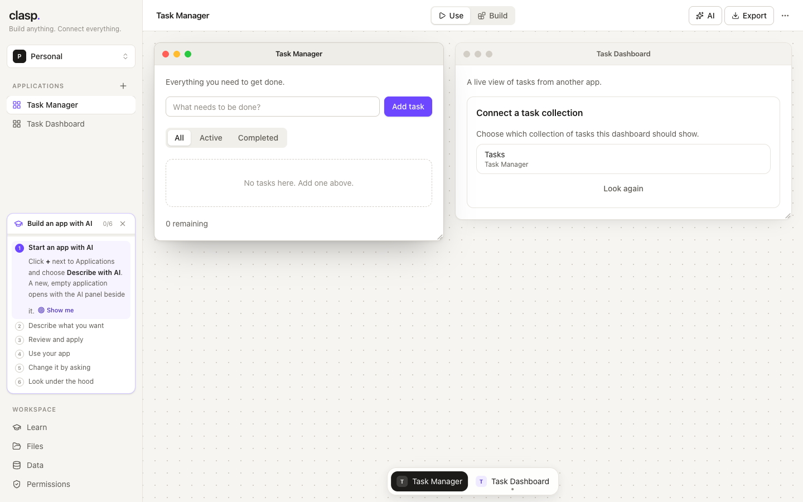
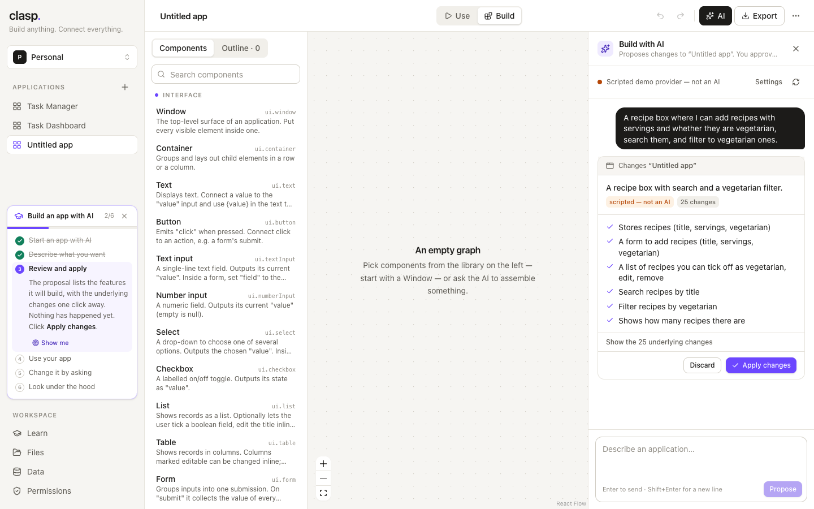
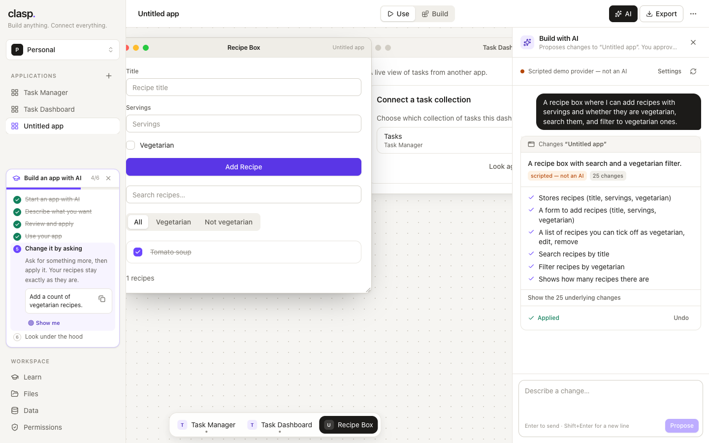
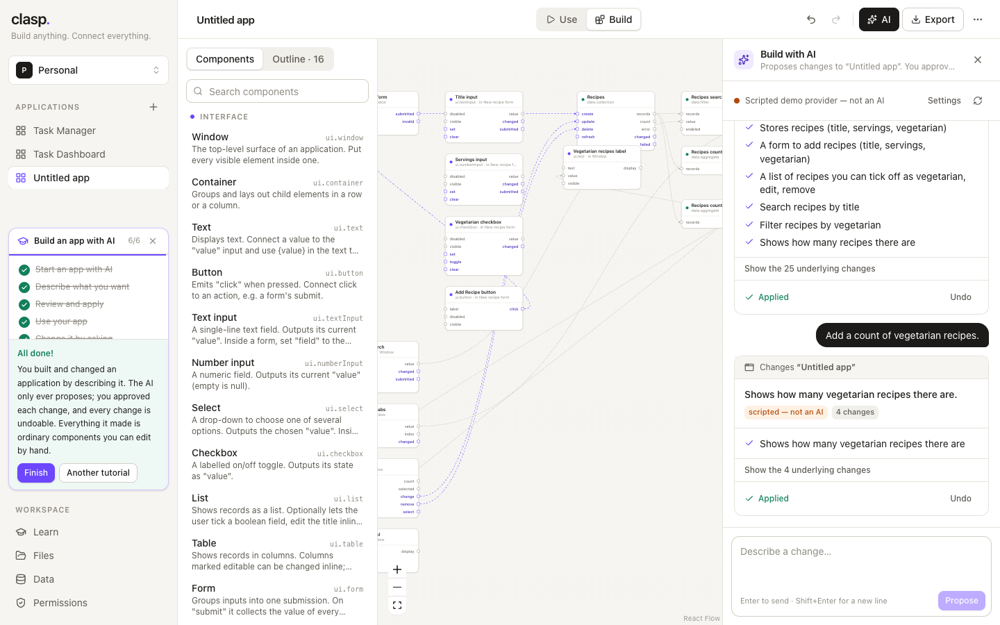
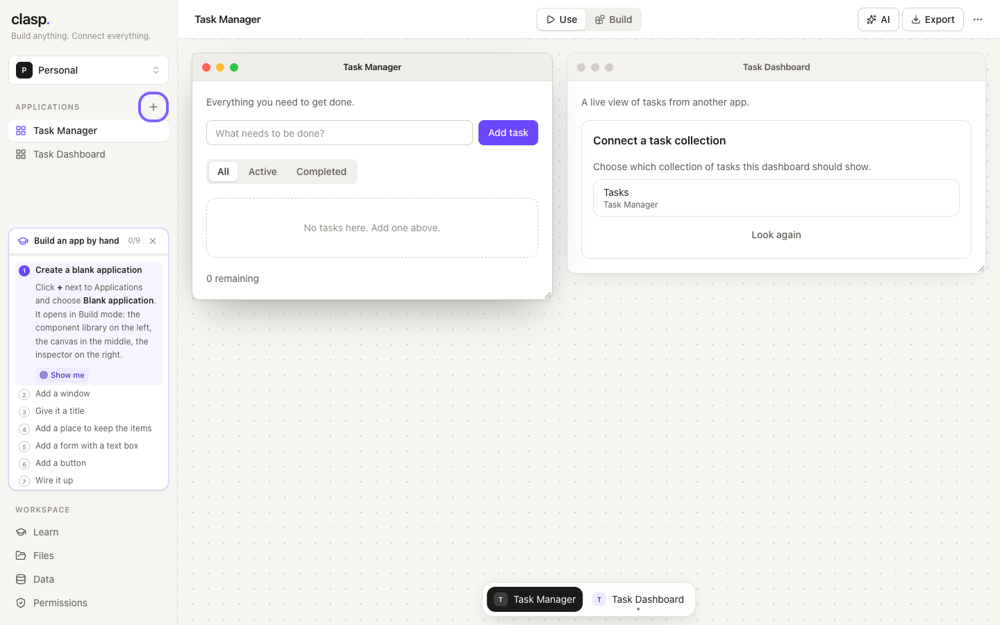
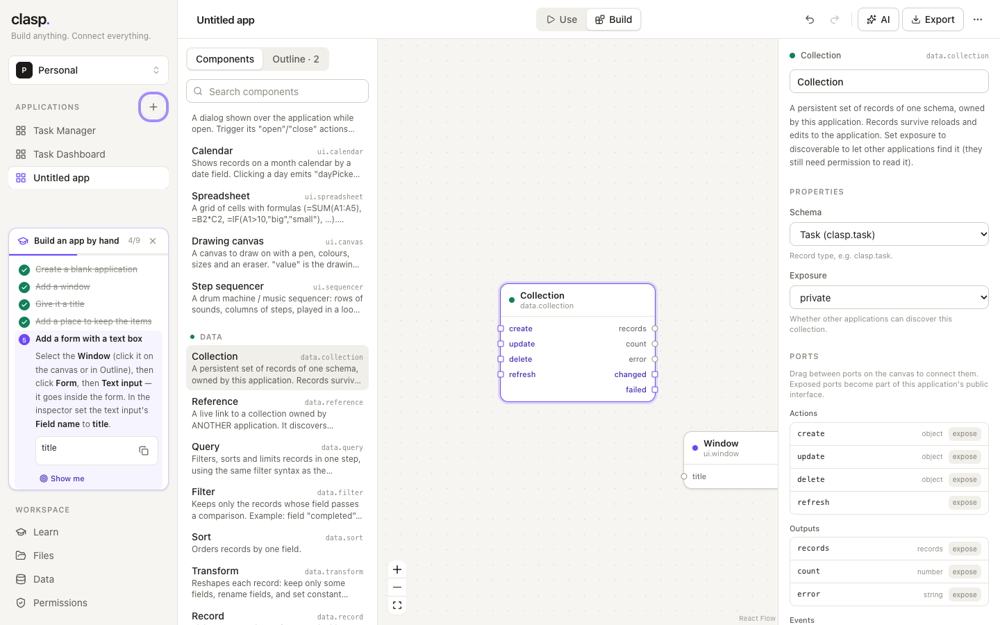
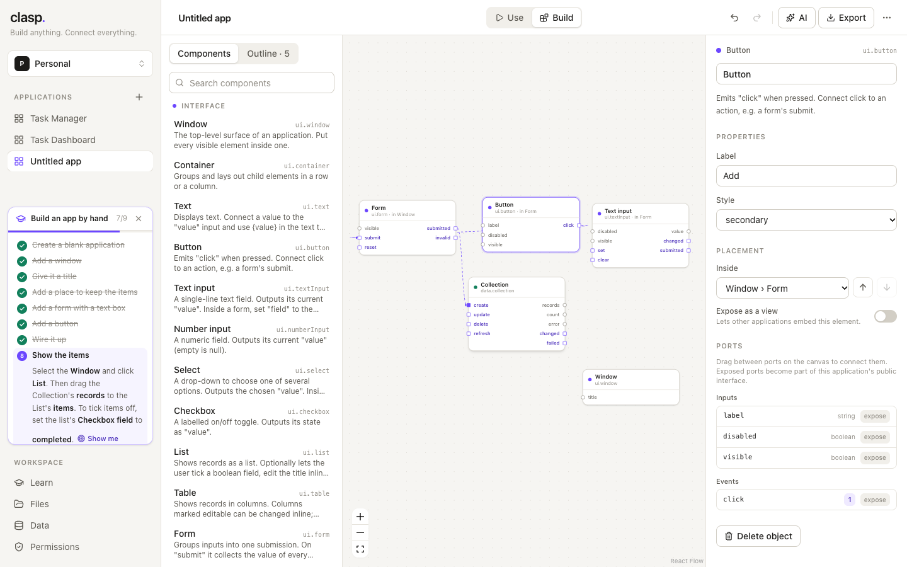
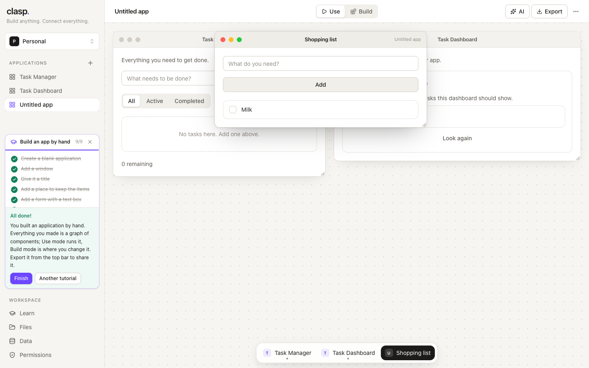

# Tutorial: build an app with AI, and by hand

Clasp has two ways to make an application, and they produce the same thing: a
graph of components you can run, inspect, change and share.

- **With AI** you describe what the app should do. The AI proposes it as a list
  of features; you approve it.
- **By hand** you place components and wire them together yourself.

Both tutorials also run **inside Clasp**: click **Learn** in the sidebar and
pick one. The steps tick themselves off as you go, and **Show me** points at
the control you need. The screenshots below come from an automated run of
those same in-app tutorials
([`tests/e2e/tutorial.spec.ts`](../tests/e2e/tutorial.spec.ts)), regenerated
with `pnpm docs:tutorial`.

---

## Part 1 — Build an app with AI (about 4 minutes)

You need a local model (see *Local AI* in the [README](../README.md)), or you
can use the **Scripted demo provider** from the AI panel's Settings. It is not
an AI: it replays prepared answers for the requests used here.

### 1. Start an app with AI

Click **+** next to *Applications* and choose **Describe with AI**. A new,
empty application opens, with the AI panel beside it.

### 2. Describe what you want

Describe the app by what it does, not how it works. Type this and press
**Propose**:

> A recipe box where I can add recipes with servings and whether they are
> vegetarian, search them, and filter to vegetarian ones.

### 3. Review and apply

The proposal is a list of **features**: where recipes are stored, a form to
add them, a list, a search and a filter. The card's top line says which
application it changes, or that it will create a new one. **Show the
underlying changes** reveals the exact components and connections. Nothing has
happened yet. Click **Apply changes**.

### 4. Use your app

Switch to **Use**. Your app runs in its own window. Add a recipe, tick
**Vegetarian**, then try the search box and the **Vegetarian** tab.

### 5. Change it by asking

Ask for something more:

> Add a count of vegetarian recipes.

Apply it. Your recipes are still there: changes reuse what the app already
has and never delete its data. Every change can be undone.

### 6. Look under the hood

Switch to **Build**. Every box is a component and every line a connection.
This is the graph the AI assembled, and you can now edit it by hand.

---

## Part 2 — Build an app by hand (about 8 minutes)

You will make a small shopping list from five components.

### 1. Create a blank application

Click **+** next to *Applications* and choose **Blank application**. It opens
in **Build** mode, which has three areas:

- the **component library** on the left;
- the **canvas** in the middle, where components appear as boxes;
- the **inspector** on the right, which configures whatever is selected.

### 2. Add a window, and give it a title

Click **Window** in the library. Everything people see goes inside a window.
With it selected, type **Shopping list** into **Title** in the inspector and
press Enter.

### 3. Add a place to keep the items

Click **Collection** (under *Data*) and set its **Schema** to
**Task (clasp.task)**. That kind of record has a title and a completed flag. A
collection's records stay safe while you change the app around them.

### 4. Add a form with a text box and a button

Select the **Window** (on the canvas or in **Outline**), then click **Form**.
Visible components go into whatever container is selected. Then click
**Text input**; it lands inside the form. Set its **Field name** to `title`
(the record field it fills) and its **Placeholder** to *What do you need?*.
With the text input still selected, click **Button**; it goes into the same
form. Set its **Label** to *Add*.

### 5. Wire it up

On the canvas, drag:

- from the Button's **click** to the Form's **submit**;
- from the Form's **submitted** to the Collection's **create**.

Square handles are **events** that trigger **actions** ("when clicked,
submit"). Round handles carry **values** ("these records go to that list").
Clasp only lets you connect things that fit.

### 6. Show the items

Select the **Window** again and click **List**. Drag the Collection's
**records** to the List's **items**. To tick items off, set the list's
**Checkbox field** to `completed`.

### 7. Use it

Switch to **Use**, type an item and press **Add**. Your app is running, and
no code was written.

---

## What to try next

- **Mix the two.** Open your shopping list, click **AI**, and ask *"Let me
  search the list"*. The AI extends the app you built by hand.
- **Share it.** **Export** in the top bar saves the app as a package, without
  your records. **+ → Import package…** brings it into another workspace.
- **Connect apps.** Set your collection's **Exposure** to *discoverable* and
  open **Task Dashboard**: it can find your list, and asks for your
  permission before it reads anything.
- **Read the design.** [architecture.md](architecture.md) explains the object
  graph, the Universal API, permissions, features, files and the AI pipeline.
